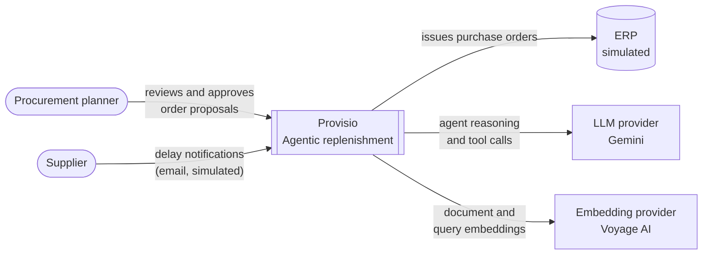
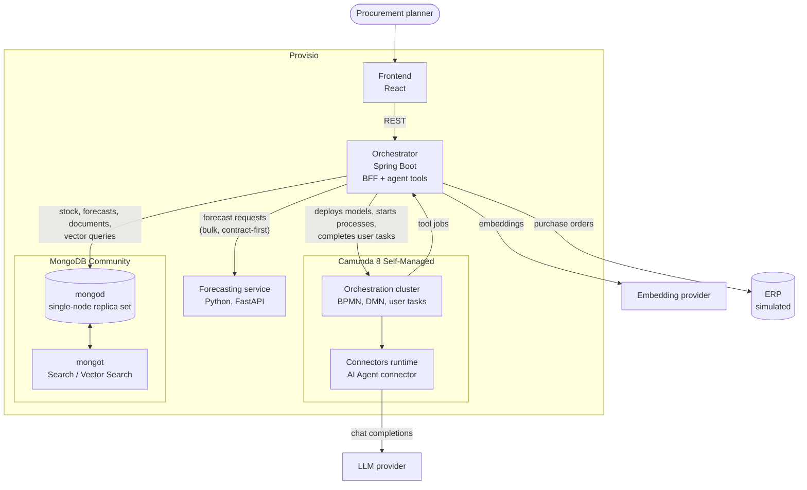

# Architecture

Diagrams follow the [C4 model](https://c4model.com/) and are written in Mermaid.

## System context

## Containers

The orchestrator is the only writer to MongoDB. The forecasting service is a stateless function with no
database access; the nightly forecast batch is started by a Camunda timer and executed by an orchestrator
worker — see [ADR 0006](../adr/0006-precomputed-forecast-with-on-demand-recompute.md).
